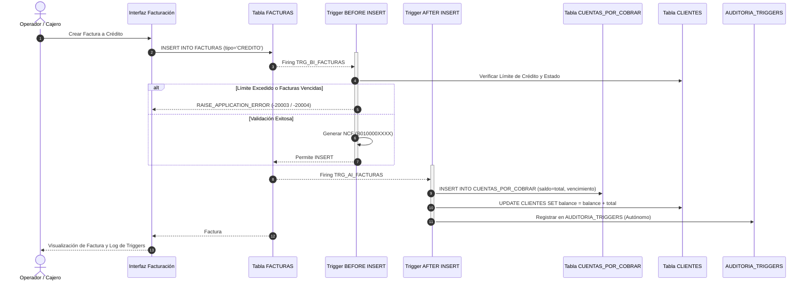

# Farmacia Carol — Integración de Facturación con Cuentas por Cobrar (CxC)
## Uso de Tecnología Propietaria de Base de Datos y Disparadores (Triggers)
### Asignatura: ISO810 — Integración de Sistemas / Tecnologías de Bases de Datos

---

## 1. Resumen Ejecutivo del Proyecto

Este proyecto aborda la integración empresarial entre el **Módulo de Facturación** y el **Módulo de Cuentas por Cobrar (CxC)** de **Farmacia Carol, S.R.L.** (RNC 130-98765-4), una de las cadenas farmacéuticas líderes de la República Dominicana.

Tradicionalmente, la integración entre Facturación y CxC suele implementarse a nivel de software mediante múltiples llamadas de servicio o código en la capa de backend. Sin embargo, este enfoque presenta serios riesgos:
- Posibilidad de **facturas a crédito huérfanas** si el servidor falla entre la creación de la factura y la creación de la cuenta por cobrar.
- Violaciones de límites de crédito por **condiciones de carrera** concurrentes.
- Sobrecarga de red debido a múltiples viajes de ida y vuelta (*roundtrips*).

Para resolver esto de forma definitiva y robusta, se implementó una **integración gobernada a nivel de motor de Base de Datos (Oracle 19c/21c)** mediante **Tecnología Propietaria de BD** y **Disparadores (Triggers)**.

---

## 2. Tecnologías Propietarias de BD Utilizadas y su Justificación

| Componente Propietario | Objeto en Base de Datos | Justificación Técnica y Beneficio Empresarial |
| :--- | :--- | :--- |
| **Disparadores (Triggers)** | `TRG_BI_FACTURAS` `TRG_AI_FACTURAS` `TRG_AI_PAGOS_CXC` `TRG_AI_NOTAS_CREDITO` `TRG_BU_CUENTAS_POR_COBRAR` | **Integridad Referencial Activa:** Garantiza que toda factura a crédito genere de forma obligatoria e indivisible su correspondiente cuenta por cobrar y actualice los balances sin intervención de la aplicación. |
| **Secuencias (Sequences)** | `SEQ_FACTURA` `SEQ_CXC` `SEQ_PAGO` `SEQ_NOTA_CREDITO` | Generación concurrente de claves primarias e IDs fiscales con opción `NOCACHE` y `NOCYCLE`, asegurando correlativos consecutivos y sin saltos para cumplimiento estricto con la DGII. |
| **Paquetes PL/SQL (Packages)** | `PKG_FARMACIA_CAROL` (Spec & Body) | Encapsulamiento de la lógica de negocio farmacéutica, variables de sesión persistentes, compilación atómica y precarga en el System Global Area (SGA) para máxima velocidad. |
| **Procedimientos y Funciones Almacenadas** | `SP_CREAR_FACTURA_CREDITO` `SP_REGISTRAR_PAGO_CXC` `SP_ACTUALIZAR_MORA` `SP_GENERAR_NCF` | Centralización de transacciones críticas ACID, cálculo exacto de ITBIS (18%) y NCF tipo B01. |
| **Cursores Explícitos (`FOR UPDATE`)** | En `SP_ACTUALIZAR_MORA` | Bloqueo pesimista a nivel de fila (`WHERE CURRENT OF c_cxc`) durante el recálculo masivo de días de mora, evitando anomalías con pagos simultáneos. |
| **Transacciones Autónomas (`PRAGMA AUTONOMOUS_TRANSACTION`)** | `SP_LOG_AUDITORIA_AUTONOMA` | Registro inalterable de auditoría forense en `AUDITORIA_TRIGGERS` que persiste incluso si la transacción de negocio principal hace `ROLLBACK`. |
| **Vistas Estándar** | `VW_ESTADO_CREDITO_CLIENTES` `VW_FACTURAS_INTEGRADAS_CXC` | Abstracción de joins complejos entre Facturación, Clientes y Cartera para consumo por APIs o pantallas de usuario. |
| **Vistas Materializadas (Materialized Views)** | `MV_AGING_CARTERA_RESUMEN` | Pre-agregación de la cartera por rangos de vencimiento (0 días, 1-30, 31-60, >60 días). Permite consultas instantáneas en el Dashboard sin impactar tablas OLTP. |
| **Programador de Tareas (`DBMS_SCHEDULER`)** | `JOB_ACTUALIZAR_MORA` | Job nocturno programado (23:00) que actualiza los días de mora de las CxC y refresca la vista materializada con `DBMS_MVIEW.REFRESH`. |

---

## 3. Arquitectura del Flujo de Integración

---

## 4. Detalle de los Disparadores (Triggers) Implementados

### 4.1. `TRG_BI_FACTURAS` (BEFORE INSERT ON FACTURAS)
- **Momento:** Antes de insertar la fila en `FACTURAS`.
- **Propósito:** 
  1. Valida que el cliente esté `ACTIVO`.
  2. Si es una venta a `CREDITO`, verifica que el cliente tenga perfil de crédito y que no posea cuentas previamente `VENCIDA`s impagas.
  3. Verifica que `(balance_actual + total_factura) <= limite_credito`. Si se excede, lanza `RAISE_APPLICATION_ERROR(-20004, ...)`.
  4. Auto-asigna el correlativo fiscal de la DGII (`B01XXXXXXXX`) mediante secuencia.

### 4.2. `TRG_AI_FACTURAS` (AFTER INSERT ON FACTURAS)
- **Momento:** Inmediatamente después de confirmarse la inserción en `FACTURAS`.
- **Propósito:**
  1. Si `tipo_pago = 'CREDITO'`, extrae los días de crédito del cliente.
  2. Calcula la fecha de vencimiento (`fecha + dias_credito`).
  3. Inserta automáticamente la fila en `CUENTAS_POR_COBRAR` con `monto_original = total`, `monto_pagado = 0`, `saldo = total`.
  4. Incrementa el balance acumulado en la tabla `CLIENTES`.
  5. Ejecuta `SP_LOG_AUDITORIA_AUTONOMA` para asentar el evento.

### 4.3. `TRG_AI_PAGOS_CXC` (AFTER INSERT ON PAGOS_CXC)
- **Momento:** Tras registrar un pago o abono contra una cuenta.
- **Propósito:**
  1. Adquiere bloqueo pesimista (`FOR UPDATE`) sobre la fila de `CUENTAS_POR_COBRAR`.
  2. Valida que el abono no genere sobrepago (`saldo >= 0`).
  3. Actualiza `monto_pagado` y `saldo`.
  4. Actualiza el estado a `PAGADA` (si saldo = 0) o `PARCIAL`.
  5. Propaga el nuevo estado a la tabla `FACTURAS`.
  6. Disminuye el `balance` del cliente en `CLIENTES`.
  7. Audita el abono en `AUDITORIA_TRIGGERS`.

### 4.4. `TRG_AI_NOTAS_CREDITO` (AFTER INSERT ON NOTAS_CREDITO)
- **Propósito:** Aplica devoluciones o descuentos por pronto pago/negociación sobre la factura y reduce automáticamente el saldo deudor de la CxC.

### 4.5. `TRG_BU_CUENTAS_POR_COBRAR` (BEFORE UPDATE ON CUENTAS_POR_COBRAR)
- **Propósito:** Trigger de integridad defensiva. Previene a nivel de base de datos cualquier intento erróneo de actualizar un saldo a cifras negativas o registrar pagos mayores al valor facturado.

---

## 5. Pruebas y Validación del Script SQL (`farmacia_carol_db.sql`)

El archivo [farmacia_carol_db.sql](file:///c:/Users/Eitha/OneDrive/Desktop/ISO810/farmacia_carol_db.sql) contiene el código completo y listo para correr en Oracle SQL Developer, SQL*Plus o Oracle Live SQL:

1. **Creación del Modelo:** Ejecuta la creación limpia de tablas, claves foráneas, índices y secuencias.
2. **Carga de Datos Iniciales:** Configura clientes con diferentes límites de crédito (Centro Médico Nacional, Clínica Abreu, Hospital Moscoso Puello, Farmacia Popular, etc.) y catálogo farmacéutico con control de ITBIS.
3. **Simulación de Facturas:** Se insertan facturas con NCF DGII, demostrando la creación automática de cuentas por cobrar.
4. **Simulación de Pagos:** Se registran transferencias y cheques, demostrando la propagación en cascada de estados.
5. **Ejecución de Job de Mora:** Recalcula días vencidos y refresca la vista materializada de cartera.

---

## 6. Acceso y Uso de la Interfaz Web Interactiva

Para explorar y presentar la solución:
1. Abra [farmacia_carol.html](file:///c:/Users/Eitha/OneDrive/Desktop/ISO810/farmacia_carol.html) en cualquier navegador web moderno.
2. Navegue por las secciones:
   - **Dashboard:** Métricas en tiempo real, KPIs de facturación, cartera vencida y barra de antigüedad de deuda.
   - **Facturas:** Lista de comprobantes fiscales emitidos, estado de pago y detalle de productos.
   - **Nueva Factura:** Simulador interactivo que permite seleccionar cliente, medicamentos, calcular ITBIS en vivo y ver la **consola de disparo de triggers paso a paso**.
   - **Cuentas x Cobrar:** Gestión de saldos, días de mora y botón para **Registrar Pago/Abono** con ventana modal.
   - **Clientes:** Monitoreo de límite de crédito, balance adeudado y porcentaje de utilización de línea de crédito.
   - **Triggers & Logs:** Visor interactivo del motor de triggers y consola de eventos en tiempo real.
   - **Arquitectura BD:** Diagrama por capas, pestañas con el código PL/SQL real y justificación técnica.
3. Puede alternar en cualquier momento entre el **Sistema de Auto-determinación TSS** ([index.html](file:///c:/Users/Eitha/OneDrive/Desktop/ISO810/index.html)) y el **Sistema de Farmacia Carol** mediante los botones de cambio rápido integrados en el encabezado.
